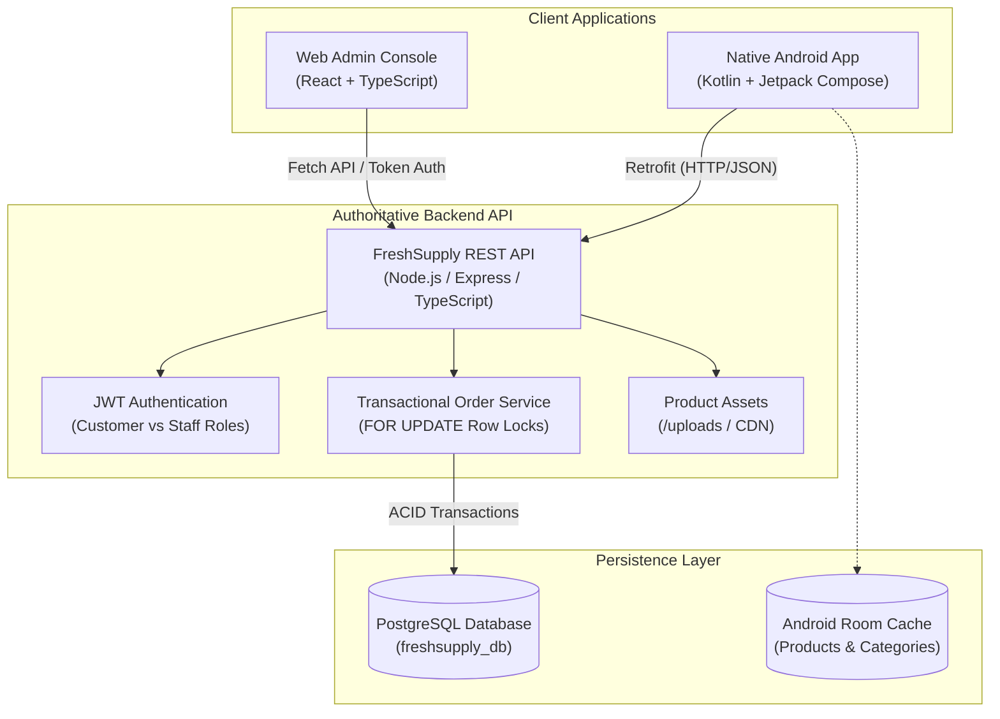

# FreshSupply — Technical Architecture Document

## 1. System Overview

FreshSupply is a production-grade B2B wholesale ordering platform designed for high-volume commercial kitchens, restaurants, cafés, banquet halls, and institutional caterers. It provides:

1. **Native Android Customer Application**: Kotlin, Jetpack Compose, Material 3, MVVM with Room caching, Flow, and DataStore.
2. **Responsive Web Admin Console**: React, TypeScript, centralized brand tokens, live status progression, and inventory management.
3. **Shared Authoritative Backend**: Node.js/TypeScript REST API with PostgreSQL connection pooling, explicit transactional isolation, row-level locking for inventory reservation, and role-based access control.

---

## 2. Core Architectural Pillars

### A. Authoritative Server-Side Truth
- **Never Trust Client Calculations**: Prices, minimum order quantities (MOQ), tax calculations (5% GST), and delivery fees are computed authoritatively on the server during checkout. Client values are strictly treated as suggestions.
- **Snapshot Immutability**: Historical order items snapshot the product name, SKU, wholesale pack size, unit, and purchase price at the exact moment of order placement. Subsequent catalog edits or price updates never alter past invoice totals.

### B. Transactional Concurrency & Inventory Safeguards
- When an order is placed, PostgreSQL locks the relevant product rows using `SELECT ... FOR UPDATE`.
- The engine checks `stock_quantity >= requested_quantity` and `quantity >= min_order_qty`.
- Stock is decremented within the same atomic transaction, and a corresponding audit entry is recorded in `inventory_logs`.
- If an order is subsequently cancelled, reserved inventory is automatically restored, and an `order_cancellation_return` movement is logged.

### C. Role-Based Access Control (RBAC)
- **Customer Access**: Restricted to their own profile, saved delivery addresses, and personal order history.
- **Operations Staff (`staff`)**: Authorized to inspect orders, update order status (`confirmed` -> `processing` -> `dispatched` -> `delivered`), adjust stock, and manage catalog items.
- **Administrator (`admin`)**: Superuser privileges including staff user creation, role assignment, customer account suspension, and executive reporting.

---

## 3. Brand Identity & Design Tokens

Both the Web Admin Console and Android Customer App implement a unified design system:

| Token Name | Hex Code | Purpose |
| :--- | :--- | :--- |
| **Primary Green** | `#16845B` | Primary actions, CTA buttons, active states |
| **Dark Green** | `#116747` | Headings, status bars, selected navigation |
| **Light Green** | `#E1F2E8` | Surface highlights, active badges, progress bars |
| **Soft Mint** | `#F0F7F2` | Subtle backgrounds, card headers, chips |
| **Main Background**| `#F7F8FA` | Neutral canvas background |
| **Card Background**| `#FFFFFF` | Elevated content surfaces |
| **Main Text** | `#202B27` | High-contrast body and title typography |
| **Secondary Text** | `#66736B` | Meta labels, SKUs, timestamps |
| **Borders** | `#DCE4DE` | Card, table, and divider outlines |
| **Error / Destructive** | `#C62828` | Critical warnings, cancellation badges |
| **Warning / Pending** | `#B7791F` | Pending status, low-stock warnings (&le; 30 units) |

---

## 4. Catalogue Hierarchy

The platform comes pre-configured with 9 mandatory B2B categories:

1. **Vegetables**: Farm-fresh daily wholesale vegetables graded for culinary kitchens.
2. **Fruits**: Grade-A fruits and wholesale beverage crates.
3. **Dairy**: Malai paneer blocks, butter blocks, cooking cream, cheeses.
4. **Rice and grains**: Aged 1121 basmati rice, sona masoori, toor dal.
5. **Spices**: Whole spices and commercial chef blends.
6. **Cooking oils**: 15L commercial tins (sunflower, mustard, groundnut).
7. **Meat and poultry**: Chilled dressed chicken cuts, eggs.
8. **Frozen foods**: French fries, IQF green peas, corn.
9. **Packaging supplies**: Meal trays, kraft paper takeaway bags, container boxes.
