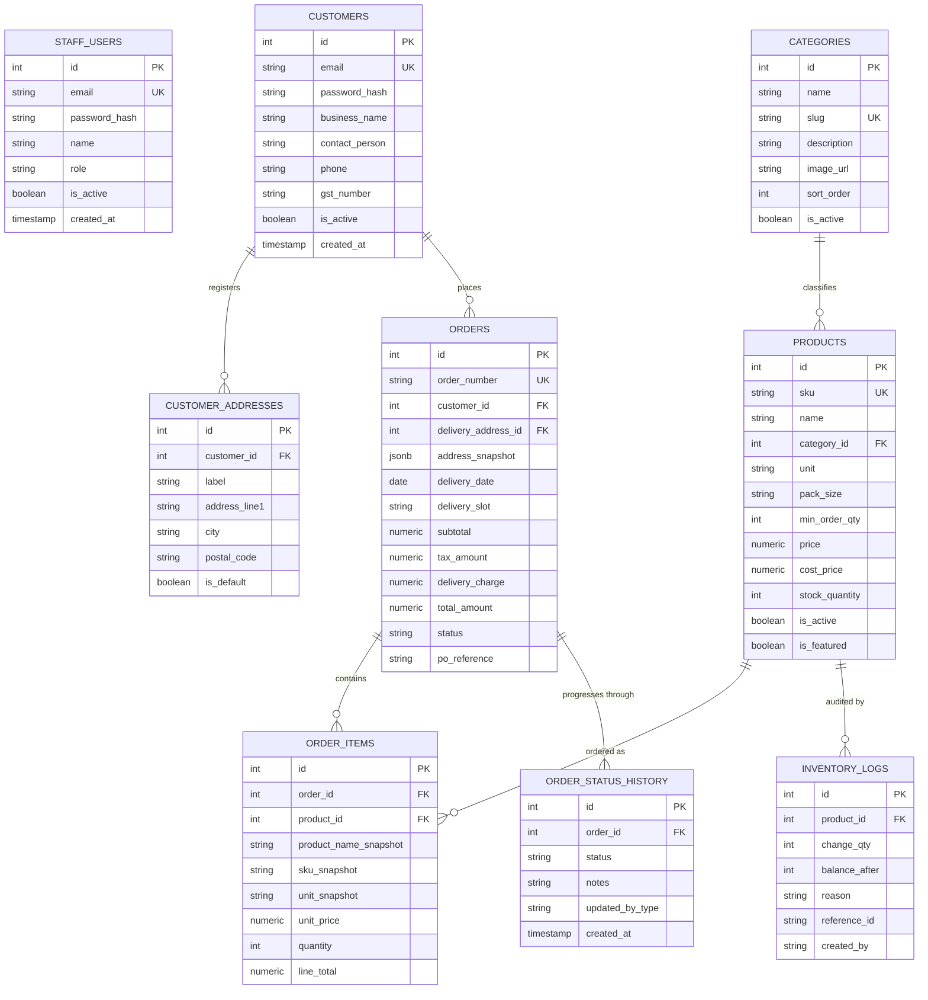

# FreshSupply — PostgreSQL Database Schema & Integrity

Database Engine: **PostgreSQL 14+**  
Default Database Name: `freshsupply_db`

---

## 1. Entity Relationship Overview

---

## 2. Table Specifications

### A. `customers`
Stores verified B2B buyers (restaurants, hotels, cafés, catering companies).
- `id`: `SERIAL PRIMARY KEY`
- `email`: `VARCHAR(255) UNIQUE NOT NULL`
- `password_hash`: `VARCHAR(255) NOT NULL` (Bcrypt 10 rounds)
- `business_name`: `VARCHAR(255) NOT NULL`
- `contact_person`: `VARCHAR(255) NOT NULL`
- `phone`: `VARCHAR(50) NOT NULL`
- `gst_number`: `VARCHAR(50)` (Optional 15-character GSTIN)
- `is_active`: `BOOLEAN NOT NULL DEFAULT true`

### B. `customer_addresses`
Stores primary kitchen receiving docks, rear entrances, and branch outlets.
- `customer_id`: `INTEGER REFERENCES customers(id) ON DELETE CASCADE`
- `label`: `VARCHAR(100)` (e.g. "Main Kitchen / Receiving Bay")
- `address_line1`, `address_line2`, `landmark`, `city`, `state`, `postal_code`
- `is_default`: `BOOLEAN DEFAULT false`

### C. `products`
The core commercial SKU catalogue.
- `id`: `SERIAL PRIMARY KEY`
- `sku`: `VARCHAR(100) UNIQUE NOT NULL` (e.g. `VEG-ONI-050`, `GRA-BAS-025`)
- `name`: `VARCHAR(255) NOT NULL`
- `category_id`: `INTEGER REFERENCES categories(id) ON DELETE RESTRICT`
- `unit`: `VARCHAR(50) NOT NULL` (e.g. `Bag (50 kg)`, `Crate (25 kg)`, `Tin (15 Litre)`)
- `pack_size`: `VARCHAR(100) NOT NULL`
- `min_order_qty`: `INTEGER NOT NULL DEFAULT 1 CHECK (min_order_qty >= 1)`
- `price`: `NUMERIC(12, 2) NOT NULL CHECK (price >= 0)`
- `cost_price`: `NUMERIC(12, 2) NOT NULL DEFAULT 0`
- `stock_quantity`: `INTEGER NOT NULL DEFAULT 0`
- `is_active`: `BOOLEAN NOT NULL DEFAULT true`
- `is_featured`: `BOOLEAN NOT NULL DEFAULT false`

### D. `orders`
Authoritative wholesale purchase records.
- `id`: `SERIAL PRIMARY KEY`
- `order_number`: `VARCHAR(100) UNIQUE NOT NULL` (`FS-YYYYMMDD-XXXX`)
- `customer_id`: `INTEGER REFERENCES customers(id) ON DELETE RESTRICT`
- `address_snapshot`: `JSONB NOT NULL` (Full physical receiving address at time of placement)
- `subtotal`: `NUMERIC(12, 2) NOT NULL`
- `tax_amount`: `NUMERIC(12, 2) NOT NULL DEFAULT 0` (5% GST)
- `delivery_charge`: `NUMERIC(12, 2) NOT NULL DEFAULT 0` (Free for orders &ge; ₹5,000, else ₹250)
- `total_amount`: `NUMERIC(12, 2) NOT NULL`
- `status`: `VARCHAR(50) CHECK (status IN ('pending', 'confirmed', 'processing', 'dispatched', 'delivered', 'cancelled'))`
- `po_reference`: `VARCHAR(100)` (Customer's internal PO #)
- `cancellation_reason`: `TEXT`

### E. `order_items`
Implements the **Price & Specification Snapshot Pattern**:
- `order_id`: `INTEGER REFERENCES orders(id) ON DELETE CASCADE`
- `product_id`: `INTEGER REFERENCES products(id) ON DELETE RESTRICT`
- `product_name_snapshot`: `VARCHAR(255) NOT NULL`
- `sku_snapshot`: `VARCHAR(100) NOT NULL`
- `unit_snapshot`: `VARCHAR(50) NOT NULL`
- `pack_size_snapshot`: `VARCHAR(100) NOT NULL`
- `unit_price`: `NUMERIC(12, 2) NOT NULL`
- `quantity`: `INTEGER NOT NULL CHECK (quantity >= 1)`
- `line_total`: `NUMERIC(12, 2) NOT NULL`

### F. `inventory_logs`
Double-entry inventory tracking movements.
- `product_id`: `INTEGER REFERENCES products(id) ON DELETE CASCADE`
- `change_qty`: `INTEGER NOT NULL` (Negative for orders, positive for inward shipments/cancellations)
- `balance_after`: `INTEGER NOT NULL`
- `reason`: `VARCHAR(100) NOT NULL` (`order_fulfillment`, `purchase_inward`, `manual_adjustment`, `damage_write_off`, `order_cancellation_return`)
- `reference_id`: `VARCHAR(100)` (e.g. Order # or Goods Received Note #)
- `created_by`: `VARCHAR(150) NOT NULL`
